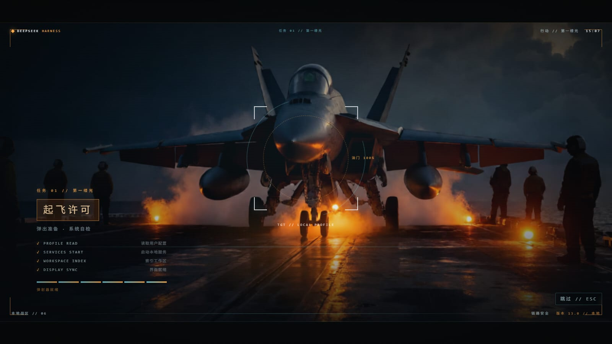
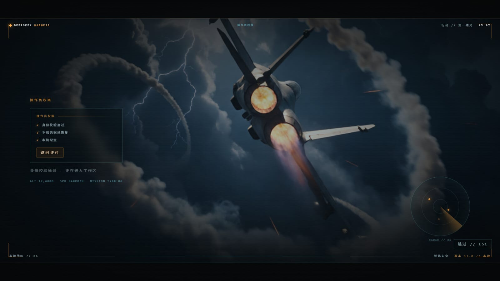

# 皇牌空战式开机序列 · DSH Ace Combat Boot

DeepSeek Harness Web UI 的电影感开机序列：四段式空战任务开场，画面由 **Agnes 生成的四张原始键 art** 构成——作战会议桌、航母甲板放飞、雷暴爬升、云海日落大标题。默认约 15 秒，四段自动衔接，结束淡入工作区。

序列只属于**一次应用启动**：冷启动播放一次；休眠唤醒、托盘恢复、页面刷新都不会重播。

当前版本：**0.13.0**

| 简报 | 起飞 |
| --- | --- |
|  |  |
| **爬升** | **标题** |
|  |  |

## 这版是什么

四段 Beats，全部 16:9 全幅铺满，HUD 由代码绘制、画面由 Agnes 绘制：

1. **简报 / BRIEF**：全息作战会议桌在暗场里缓慢漂移；左边一枚原创菱形翼徽章，右边 `DEEPSEEK / HARNESS` 字标划开，`OPERATION // FIRST LIGHT` 与指挥链路进度条逐步建立。
2. **放飞 / LAUNCH**：航母甲板，弹射器蒸汽与琥珀跑道灯；锁定框压住机头，白字盖章 `LAUNCH CLEARANCE`，`PROFILE READ → SERVICES START → WORKSPACE INDEX → DISPLAY SYNC` 逐行点亮。
3. **爬升 / ASCENT**：雷暴云层中的加力爬升，镜头轻震；左侧 `OPERATOR ACCESS` 卡片逐条校验身份、凭据与本机配置，右侧雷达开始扫描，`ACCESS GRANTED` 盖章。
4. **标题 / TITLE**：云海日落，战机拖着两条尾迹飞向太阳；大标题、三枚状态 chip、`按 Enter 继续` 与自动继续进度条，任务完成 HUD。

画面是原创生成图，不含任何游戏截图、字体、音频、标志或商标；"皇牌空战风格"指空战任务简报的构图与 HUD 语汇，不是对具体作品的复制。

## 画面资产（Agnes）

四张背景由 Agnes 图像模型 `agnes-image-2.5-flash` 生成，提示词只描述原创空战场景（虚构战机、原始构图、无标志无文字），成品转为 JPEG 放在 `assets/`：

| 文件 | 场景 |
| --- | --- |
| `assets/briefing.jpg` | 俯视全息作战桌，发光线路线与航点 |
| `assets/deck.jpg` | 黎明航母甲板，弹射蒸汽与琥珀灯光 |
| `assets/ascent.jpg` | 雷暴云层中的加力爬升 |
| `assets/horizon.jpg` | 云海日落与双尾迹战机 |

Host 半侧把它们挂在 `/acb/assets/<name>.jpg` 下只读输出；客户端按 `?v=<ART_VERSION>` 取图并预加载。换图时把 `client.js` 里的 `ART_VERSION` 加一，再刷新插件即可，不需要重启 Host。

## v0.13.0：启动兼容性修复

v0.12.0 之后 DSH 出现过一次启动失败（`Host startup exceeded 60 seconds`），启动日志里 ac-boot 留下了这条报错：

```
[ac-boot] workspace data route was not registered
Error: cannot get property "webServer" without inject
```

原因是 Host 半侧在没有声明 `inject` 的情况下读取了 `webServer` / `workspaceRegistry`。旧版还因此在每次启动时抛错；地图数据实际上从未取到真实工作区，一直用的是内置示例。

v0.13.0 的 Host 半侧被收窄到最小：

- 显式导出 `name` 与 `inject = ['webServer']`，不再读取 `workspaceRegistry`；
- 不注册 `/acb/workspaces`，不做任何工作区快照；
- 注入表只保留首帧 splash 的 `html` + `style` 两行（不再新增 `script` 行）；
- 唯一新增的常驻内容是 `/acb/assets/` 只读静态路由；
- 所有回调都包在 `try/catch` 里，激活阶段没有 await、没有网络请求、没有同步重活。

也就是说，这个插件现在**没有能力拖慢或打断 Host 启动**；最坏情况只是图片路由缺失，客户端退回深色渐变背景。

## 安装

这是一个 DSH bundle/plugin（`package.json` 的 `dsh.bundle` + `dsh.client`），不是独立网页，也不是 npm 公共包。

### 1. 放到 profile 的 node_modules

以桌面端默认 `desktop` profile 为例。

Windows PowerShell：

```powershell
$profileRoot = "$env:USERPROFILE\.dsh\profiles\desktop"
$target = Join-Path $profileRoot "node_modules\@local\dsh-ac-boot"
New-Item -ItemType Directory -Force (Split-Path $target) | Out-Null

# 先 clone 到任意源码目录
git clone https://github.com/MosesMuxiXie/dsh-ac-boot.git "$env:USERPROFILE\src\dsh-ac-boot"

# 如果 target 已存在，先确认它不是要保留的真实目录
New-Item -ItemType SymbolicLink -Path $target -Target "$env:USERPROFILE\src\dsh-ac-boot"
```

macOS / Linux：

```bash
profileRoot="$HOME/.dsh/profiles/desktop"
mkdir -p "$profileRoot/node_modules/@local"
git clone https://github.com/MosesMuxiXie/dsh-ac-boot.git "$HOME/src/dsh-ac-boot"
ln -s "$HOME/src/dsh-ac-boot" "$profileRoot/node_modules/@local/dsh-ac-boot"
```

也可以直接把仓库内容复制到 `node_modules/@local/dsh-ac-boot`，不建符号链接。

### 2. 启用插件

在 DSH 的「设置 → 插件」里启用 **开机序列 · 启动动画**（此前被临时禁用的，在这里重新打开）。如果插件没有自动出现在列表中，把仓库根目录的 `cordis.patch.yml` 合并到 profile 的 `cordis.patch.yml`：

```yaml
- insert:
    - id: ac-boot
      name: '@local/dsh-ac-boot'
```

`package.json` 已经声明：

- `dsh.bundle.patch` → `./cordis.patch.yml`
- `dsh.client.platform` → `web`
- `dsh.client.immediately` → `true`

### 3. 重启边界

- **首次安装 / 重新启用**：需要完整退出 DSH（托盘 → 退出，或应用菜单退出）再启动一次。桌面端会在 Host 进程启动时缓存 `webserver/index-inject` 的注入结果，因此首帧 splash 和 `/acb/assets` 这类 Host 侧内容必须等一次应用级重启。
- **之后的客户端更新**（画面、HUD、文案、时序）：可以用 DSH 的**插件刷新 / Unlag 刷新**重载客户端，不必完整退出应用。见下面的「热加载」。
- **换背景图**：更新 `assets/*.jpg`，把 `client.js` 的 `ART_VERSION` 加一，再刷新插件；图片路由每次请求都读磁盘，不需要重启 Host。

## 启动行为

开机序列只属于一次应用启动：

- 冷启动 DSH（完全退出后重新启动）播放一次；
- 休眠 / 睡眠唤醒、锁屏恢复、托盘窗口重新打开、同一窗口内页面重载都不会自动重播；
- 播放开始时客户端往 `sessionStorage` 写入 `acb-boot-played` 标记。同一窗口会话内再加载页面时，客户端直接跳过序列并移除 Host 注入的 splash；
- 手动重播始终可用：`Ctrl+Alt+Shift+B` 或控制台 `window.__ACB_REPLAY()`；同一窗口内插件模块热替换（HMR）仍会自动重播一次，方便预览；
- 想再看一次冷启动效果：把 DSH 完全退出（托盘 → 退出）再启动。

> 为什么用 `sessionStorage`：它跟着窗口会话走。页面重载、休眠唤醒、Electron 渲染进程重载都保留它，所以不会重播；真正退出应用时窗口会话销毁，标记随之消失，下次启动重新播放。

## 热加载

客户端模块带 build fingerprint。同一窗口内模块被热替换时，新的 `BootHost` 会检测到新 build 并自动重播整个开场，不需要退出应用。整页重载（Unlag 的界面重建走页面重载）不会自动重播，用下面的手动入口预览。

手动重播：

- 按 `Ctrl+Alt+Shift+B`
- 或在控制台执行：

  ```js
  window.__ACB_REPLAY()
  ```

推荐工作流：

1. 修改 `client.js` / HUD / 画面文案；
2. 在 DSH 里触发插件刷新（Unlag / 插件管理器重载）；
3. 如果新模块是同一窗口热替换，会自动重播；整页重载则按上面的快捷键手动预览。

只有改 Host 半侧（`index.js`、`boot-splash.js`、`/acb/assets` 路由、splash 注入）才需要应用级重启。

## 文件

| 文件 | 说明 |
| --- | --- |
| `index.js` | Host 半侧：首帧 splash 注入、`/acb/assets/` 只读图库路由；`inject = ['webServer']` |
| `boot-splash.js` | 首帧 splash 的 HTML/CSS，无脚本、8 秒淡出兜底 |
| `client.js` | 四段空战开场、HUD、Agnes 背景、启动去重、热重播、i18n、跳过与减少动态 |
| `assets/*.jpg` | Agnes 生成的四张 16:9 背景（约 590 KB） |
| `cordis.patch.yml` | bundle 插入 `ac-boot` 插件行 |
| `locale/*.json` | 插件管理页标题与描述 |
| `icon.svg` | 插件图标 |
| `docs/boot-*.jpg` | 四段画面预览 |
| `docs/agnes-prompts.md` | 四张背景的原始 Agnes 提示词与请求参数 |
| `scripts/agnes-gen.mjs` | Agnes 生图辅助脚本（开发用，从 `AGNES_API_KEY` 读 Key） |

## 调参

- 总时长：`client.js` 顶部 `DURATION_MS`（默认 `15000`）
- 四段切换：`PHASES`（默认 `0 / 2600 / 6200 / 9800 ms`）
- 减少动态效果时长：`REDUCED_MS`（默认 `5200`）
- 淡入淡出：`FADE_MS`（默认 `800`）
- 覆盖层级：`ORDER`（默认 `9000`）
- 背景图版本：`ART_VERSION`（默认 `13`，换图时 +1）
- 启动去重标记：`sessionStorage['acb-boot-played']`（客户端与 splash 去重共用；清掉它可让下一次页面重载重新播放）

## 交互

- 点击任意处 / `Esc` / `Enter` / `Space` 跳过；
- 动画中隐藏窗口，回来会继续，不会从头重播；
- 播放结束后隐藏 / 重新打开窗口、休眠唤醒都不会重播；需要重看用上面的手动重播；
- `prefers-reduced-motion` 下使用较短时序的静态版，保留信息、去掉位移与强光；
- 覆盖层使用 `shell.overlay` 槽位，遮住桌面宠物等底层元素。

## 设计说明

- 视觉语言参考空战任务简报/游戏 HUD 的构图与信息密度，**代码、HUD、图标全部原创，背景图由 Agnes 依据原创提示词生成，不含任何游戏素材、字体、音频、商标或真实机徽**。
- 四段动画只对 `transform` / `opacity` / `clip-path` 等合成属性做过渡；React 只切换阶段，不写逐帧样式。
- 背景图是 1312×736 JPEG，按 `cover` 铺满；大屏上依赖暗角、扫描线与颗粒遮瑕，属于电影感的静态底图而不是 4K 素材。
- 已知限制：DSH 桌面端缓存 Host 注入是平台行为，无法从插件侧绕过；因此 splash 和 `/acb/assets` 路由的更新始终需要一次应用级重启。

## 生成记录

- 图像模型：Agnes `agnes-image-2.5-flash`，尺寸 1280×720（上游返回 1312×736），seed 未固定，四张各一次成功生成。
- 提示词只描述原创场景，例如“劫持航母甲板黎明放飞”（对应 `deck.jpg`）、“云海日落双尾迹战机”（对应 `horizon.jpg`），并明确要求 no text / no logos / no insignia / no real-world aircraft markings。
- 成品压缩为 JPEG（quality 90），合计约 590 KB，随仓库分发。

## License

仓库目前未声明开源许可证。如需 MIT / Apache-2.0 或私有使用说明，请先补充 LICENSE 再重新发布。
