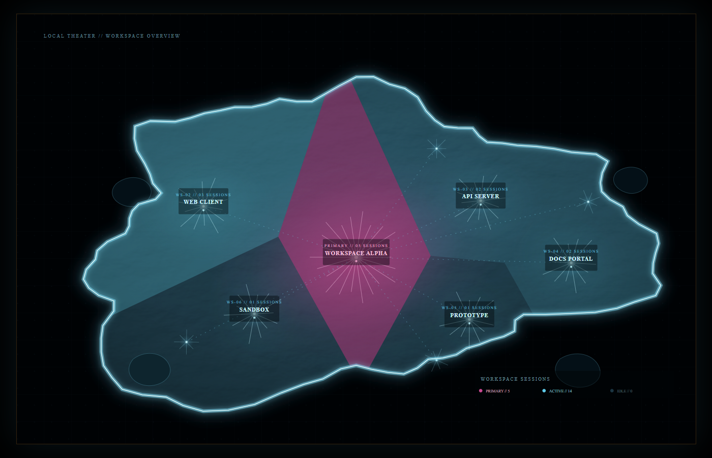

# 战术简报开机序列 · DSH Tactical Briefing Boot

DeepSeek Harness Web UI 的电影感开机序列，受战术任务简报界面启发：星场 + 全息上行、全幅工作区剧场地图、操作员登录、星球地平线标题。默认约 15 秒，四段自动衔接，结束淡入工作区。

当前版本：**0.11.0**



## 这版是什么

- **Logo**：星空、全息地球环、`DEEPSEEK / HARNESS` 上行，带战术 HUD 与运行进度。
- **Boot**：全幅工作区剧场地图。45° 倾斜转俯视，白热 flash + 宽 bloom + 横向 streak，随后多点节点 rays/连线依次点亮，最后加载区域局势。
- **Login**：深色全息操作员登录卡叠加在地图上；琥珀警示条、扫描线、凭据与访问校验。
- **Title**：近黑星球地平线大标题，冰青主光 + 琥珀地平线，恢复剩余的战术 HUD。

地图不是静态装饰：Host 端读取真实的 `workspaceRegistry`，按每个工作区的 `sessionIds` 数量生成 Voronoi 区域。

- 会话最多的工作区：**品红主区**；
- 其他活跃工作区：**青色区域**，会话越多越亮；
- 0/低会话区域：接近深黑蓝；
- 每个区域带工作区标题、`WS-xx` 与会话数；右下角是 `PRIMARY / ACTIVE / IDLE` 图例；
- 地形层使用程序化 hillshade，海面有细网格、海岸 shelf 与发光海岸线，内部不画路线/等高线等硬线；
- 右侧信息列已删除；地图全幅铺满内容区，左侧 `TGT / MISSION / OPERATION` 变成悬浮 HUD。

## 安装

这是一个 DSH bundle/plugin（`package.json` 的 `dsh.bundle` + `dsh.client`），不是独立网页，也不是 npm 公共包。

### 1. 放到 profile 的 node_modules

以桌面端默认 `desktop` profile 为例。

Windows PowerShell：

```powershell
$profileRoot = "$env:USERPROFILE\.dsh\profiles\desktop"
$target = Join-Path $profileRoot "node_modules\@local\dsh-ac-boot"
New-Item -ItemType Directory -Force (Split-Path $target) | Out-Null

# 先 clone 到任意源码目录
git clone https://github.com/MosesMuxiXie/dsh-ac-boot.git "$env:USERPROFILE\src\dsh-ac-boot"

# 如果 target 已存在，先确认它不是要保留的真实目录
New-Item -ItemType SymbolicLink -Path $target -Target "$env:USERPROFILE\src\dsh-ac-boot"
```

macOS / Linux：

```bash
profileRoot="$HOME/.dsh/profiles/desktop"
mkdir -p "$profileRoot/node_modules/@local"
git clone https://github.com/MosesMuxiXie/dsh-ac-boot.git "$HOME/src/dsh-ac-boot"
ln -s "$HOME/src/dsh-ac-boot" "$profileRoot/node_modules/@local/dsh-ac-boot"
```

也可以直接把仓库内容复制到 `node_modules/@local/dsh-ac-boot`，不建符号链接。

### 2. 启用插件

在 DSH 的「设置 → 插件」里启用 **开机序列 · 启动动画**。如果插件没有自动出现在列表中，把仓库根目录的 `cordis.patch.yml` 合并到 profile 的 `cordis.patch.yml`：

```yaml
- insert:
    - id: ac-boot
      name: '@local/dsh-ac-boot'
```

`package.json` 已经声明：

- `dsh.bundle.patch` → `./cordis.patch.yml`
- `dsh.client.platform` → `web`
- `dsh.client.immediately` → `true`

### 3. 重启边界

- **首次安装**：需要完整退出 DSH（托盘 → 退出，或应用菜单退出）再启动一次。桌面端会在 Host 进程启动时缓存 `webserver/index-inject` 的注入结果，因此首帧 splash 和 `/acb/workspaces` 这类 Host 侧内容必须等一次应用级重启。
- **之后的客户端更新**（地图、动画、CSS、区域、光照）：可以直接用 DSH 的**插件刷新 / Unlag 刷新**重载客户端，不必完整退出应用。见下面的「热加载」。
- **页面普通刷新**：不保证能拿到新的客户端模块——桌面端可能复用启动时的模块图。优先用插件刷新。

## 热加载

客户端模块带 build fingerprint。同一窗口内模块被热替换时，新的 `BootHost` 会检测到新 build 并自动重播整个开场，不需要退出应用。

手动重播：

- 按 `Ctrl+Alt+Shift+B`
- 或在控制台执行：

  ```js
  window.__ACB_REPLAY()
  ```

推荐工作流：

1. 修改 `client.js` / 地图 / CSS；
2. 在 DSH 里触发插件刷新（Unlag / 插件管理器重载）；
3. 新模块加载后自动重播；如果没自动播放，按上面的快捷键。

只有改 Host 半侧（`index.js`、`boot-splash.js`、splash 注入、`/acb/workspaces` 路由）才需要应用级重启。

## 地图数据

Host 通过 `workspaceRegistry.list()` 生成快照：

- 注入 `window.__ACB_WORKSPACES` 供首帧使用；
- 注册 `GET /acb/workspaces` 返回实时 JSON（`{ list: [{ title, path, sessions, updatedAt }] }`）。

客户端优先拉实时接口，失败时用启动快照，再失败才用占位工作区。因此换工作区 / 增删会话不需要重启动画；刷新一次开场即可读到最新数据。

最多展示 8 个工作区；更多会折叠为 `OTHER WORKSPACES`。

## 文件

| 文件 | 说明 |
| --- | --- |
| `index.js` | Host 半侧：注入首帧 splash、启动快照、`/acb/workspaces` 路由 |
| `boot-splash.js` | 首帧 splash 的 HTML/CSS，无脚本、8 秒淡出兜底 |
| `client.js` | 四段开机序列、全幅地图、多节点 rays、地形、热重播、i18n、跳过与减少动态 |
| `cordis.patch.yml` | bundle 插入 `ac-boot` 插件行 |
| `locale/*.json` | 插件管理页标题与描述 |
| `icon.svg` | 插件图标 |
| `docs/workspace-map.png` | 地图组件静态预览（示例工作区数据） |

## 调参

- 总时长：`client.js` 顶部 `DURATION_MS`（默认 `15000`）
- 四段切换：`PHASES`（默认 `0 / 2400 / 5700 / 9000 ms`）
- 减少动态效果时长：`REDUCED_MS`（默认 `5200`）
- 淡入淡出：`FADE_MS`（默认 `800`）
- 覆盖层级：`ORDER`（默认 `9000`）
- 首帧 splash 自动淡出：`boot-splash.js` 的 `8s`
- 地图区域数、锚点、配色：`client.js` 中 `WORKSPACE_MAP_ANCHORS` 与 `WorkspaceMap`
- 区域热度曲线：`heat = Math.pow(ratio, 1.12)`，以及 `fillOpacity` / 径向光晕
- 多点 rays / 连线：`nodeBursts`、`relayBursts`、`networkLinks`
- 窗口重开兜底：`REPLAY_ON_FOCUS`（默认 `false`）

## 交互

- 点击任意处 / `Esc` / `Enter` / `Space` 跳过；
- 窗口关闭到托盘后重新打开会重播；
- 动画中隐藏窗口，回来会继续；结束后隐藏再打开会重播；
- `prefers-reduced-motion` 下显示约 5 秒的静态版，保留信息、去掉位移与强光；
- 地图覆盖层使用 `shell.overlay` 槽位，遮住桌面宠物等底层元素。

## 设计说明

- 视觉语言参考战术简报/空战 HUD 的构图与信息密度，**代码、地图轮廓、图标全部为原创实现，不含任何游戏素材、字体或音频**。
- 地图是虚构剧场大陆，不是现实世界地图，也不是任何游戏地图的复制。
- 动画只对 `transform` / `opacity` / `clip-path` 等合成属性做过渡；React 只切换阶段。
- 已知限制：DSH 桌面端缓存 Host 注入是平台行为，无法从插件侧绕过；因此 splash 和 Host 路由的更新始终需要一次应用级重启。

## License

仓库目前未声明开源许可证。如需 MIT / Apache-2.0 或私有使用说明，请先补充 LICENSE 再重新发布。
